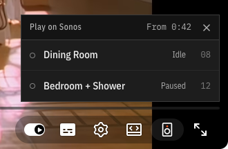
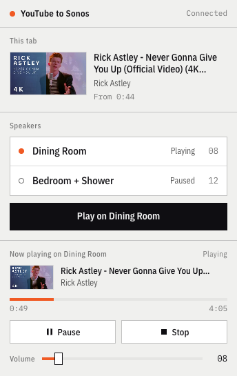

# YouTube to Sonos

A Chrome extension and a small Mac companion that play the sound of any YouTube video on your Sonos speakers. Click the speaker button in the YouTube player, pick a room, and it carries on from where you were while YouTube pauses itself.

 

## Why it exists

Sonos has no YouTube app, so a DJ set, a live session or an old track that only exists on YouTube has no route to the speakers. Newer Sonos speakers can take AirPlay 2 from a Mac, but older ones (Play:1, the first Play:5 and others) can't. Mirroring your Mac's sound also means every notification goes through the speakers.

This sends just the audio of the video you're watching, to the room you pick, and leaves your Mac's own sound alone.

## What you need

1. A Mac on the same wifi as the speakers.
2. Chrome.
3. Node 24 or newer, yt-dlp and ffmpeg. With Homebrew: `brew install node yt-dlp ffmpeg`.

## Install

1. Download this repo:
   ```
   git clone https://github.com/PepoBCN/youtube-to-sonos.git
   cd youtube-to-sonos
   ```
2. Start the companion. It runs in the background, starts when you log in and restarts itself if it ever stops:
   ```
   ./companion/install.sh
   ```
   When it works you'll see a line starting `Running:`.
3. Add the extension to Chrome: open `chrome://extensions`, switch on Developer mode (top right), click "Load unpacked" and choose the `extension` folder.
4. Pin it from the puzzle-piece menu so the speaker icon sits in the toolbar.

## Use it

1. On any YouTube video, click the speaker button in the player bar (next to the settings cog) and pick a speaker. A new song takes about 10 seconds to start and a long mix up to a minute. Anything you've played before starts almost straight away.
2. The toolbar popup shows what's playing, with pause, stop and volume.
3. Right-click any YouTube link and choose "Play on Sonos" to send it to the last speaker you used.

YouTube tabs that were already open when you installed the extension need a reload before the button shows.

## How it works

Chrome can't find Sonos speakers or serve audio to them by itself, so the extension asks the companion to do both.

1. The extension tells the companion which video, which speaker and where you were in the video.
2. The companion uses yt-dlp to save just the audio as an MP3 in `~/Library/Caches/youtube-to-sonos`.
3. It shares that MP3 on your home network and tells the speaker, over Sonos's own local control interface, to play it from the right point, with the title and thumbnail so the Sonos app shows them.
4. Pause, stop and volume go the same way.

The controls only answer requests from the Mac itself and only from the extension, so nobody else on the network and no web page open in Chrome can drive your speakers through it. The cache tidies itself: anything not played for 30 days goes, and it never grows past 2 GB.

The full list of what the companion answers is in [docs/API.md](docs/API.md). It's plain Node with no packages to install. The extension is Manifest V3 with no build step.

## Limits

1. It plays one video at a time. A YouTube Mix or playlist stops on the speaker after the current track.
2. Mac only, because the companion runs as a macOS login item.
3. Private, age-restricted and live videos can't be fetched. The error says which.

## If something goes wrong

1. The extension says the companion isn't running: copy the command it shows into Terminal, or run `./companion/install.sh` again.
2. The log is at `~/Library/Logs/youtube-to-sonos.log`.
3. No speakers found: check the Mac is on the same wifi as the speakers. If macOS asks whether `node` can find devices on your local network, say yes (System Settings, Privacy and Security, Local Network).
4. It stopped after a Node upgrade: run `./companion/install.sh` again and it picks up the new version.

## Uninstall

1. `./companion/uninstall.sh` stops the companion and removes it from start-up. Add `--delete-cache` to delete the saved audio too.
2. Remove the extension from `chrome://extensions`.

## Tests

1. Companion: `cd companion && node --test`.
2. Extension against a fake companion, using Playwright's own Chromium: `cd extension && node tests/run-tests.mjs`.
3. Live on one of your speakers at low volume, then stopped and the volume put back. It replaces whatever that speaker was playing, so pick an idle one: `cd extension && SPEAKER="Kitchen" node tests/live-e2e.mjs`.

## Please use it fairly

This is for playing videos you could watch anyway on speakers in your own home. Please respect YouTube's terms and the people who made the music.

## Licence

MIT, see [LICENSE](LICENSE). The bundled IBM Plex fonts are under the SIL Open Font License, see `extension/fonts/OFL.txt`.
